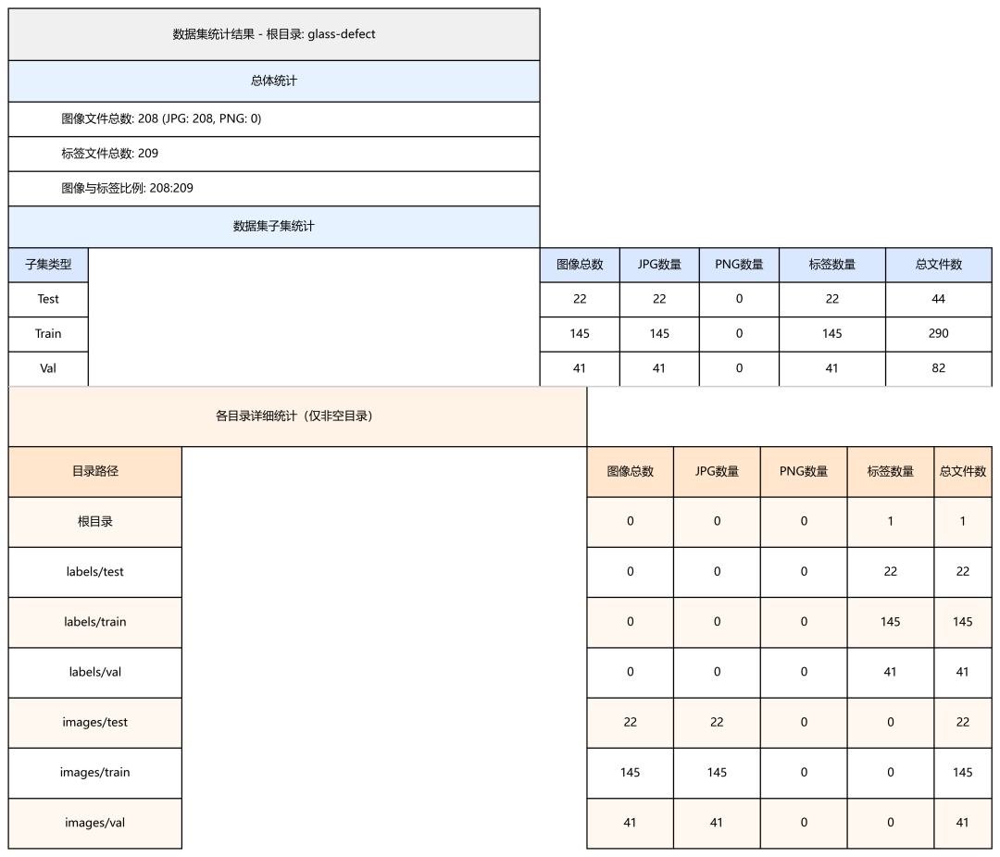
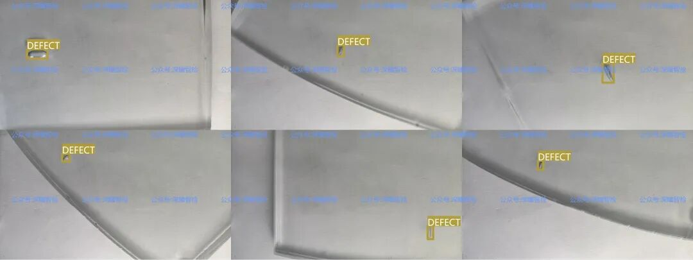
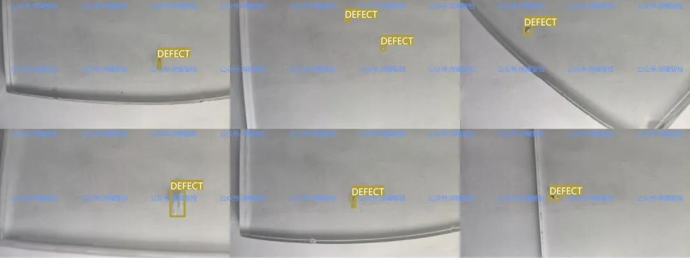
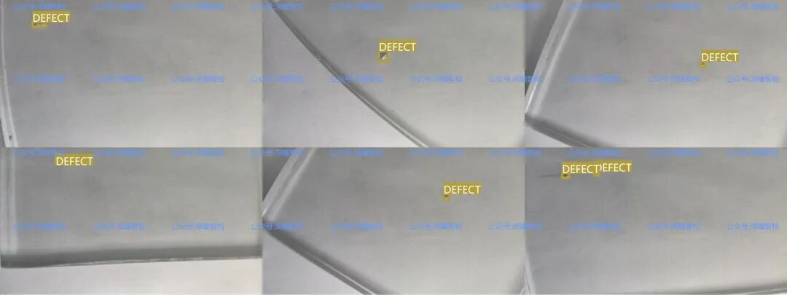

# Target Detection Dataset Issue 011 - Glass Defect Detection Dataset Based on YOLO Annotation Format

#### 1. Data Set Background

In the field of industrial manufacturing, laminated glass (also known as tempered glass) is widely used in applications such as building facades, car windshields, and electronic device screens due to its high strength and resistance to impact. However, its production process can easily produce defects like bubbles, layering, and metal particles due to factors such as raw material purity and fluctuations in process parameters. These defects not only affect the product appearance but also potentially weaken the structural stability of the glass, posing safety risks.

Traditionally, the defect detection of laminar glass relies on manual visual inspection, which is not only inefficient (each piece of glass requires several minutes to be inspected), but also susceptible to subjective factors such as the experience and fatigue level of the inspectors, resulting in a high rate of missed or incorrect detections. With the penetration of artificial intelligence technology into industrial quality inspection, automated defect detection solutions based on computer vision have gradually become mainstream —— and high-quality, standardized datasets are the core foundation for training such AI models. The glass defect detection dataset recommended today is specifically developed for the development of laminar glass defect detection models, perfectly solving the pain points of data scarcity and unstandardized labeling in industrial scenarios.

2. Data Details

The glass defect dataset has fully considered the needs of industrial AI model development in terms of content design and format specifications. It is "plug-and-play" for data partitioning, defect types, and annotation formats, with specific details as follows:

##### (1) Core data content

The dataset focuses on the defect detection of "small sandwich glass samples", covering the most common defects in industrial production and most actual quality inspection scenarios:

-

• **Bubble (Bubbles)**: A hollow defect formed between the glass layers due to incomplete air removal, the most common defect type in the production of laminated glass;

-

• **Layering (Delamination)**: The glass is not closely bonded to the intermediate layer material (such as PVB film), resulting in local separation defects, which will directly affect the glass's impact resistance.

-

• **Metallic Particles**: Impurities of metals mixed in during the production process. Not only affect appearance, It may also cause localized stress concentration in the glass during long-term use.

All sample images are in **high-resolution formats**, which can clearly display the detailed characteristics of defects (such as the edges of bubbles, and the differences in texture layers), avoiding the problem that the model cannot learn effective defect features due to image blurring.

##### (2) Data Splitting and Structure

To meet the full-process development needs of the model "Training - Validation - Testing", the dataset has been pre-divided according to the usual proportions for industrial AI model development, without the need for additional user processing:

|

Data subset

 ||

Corresponding folder

 ||

Core role

 |

|

Training set

 ||

images/train

 ||

Used for model parameter learning, to let the model master the characteristic laws of defects.

 |
|

Validation set (Val)

 ||

images/val

 ||

Used for hyperparameter tuning of models (such as learning rate, batch size), to prevent overfitting.

 |
|

Test set

 ||

images/test

 ||

Used for objectively evaluating the generalization ability of the model, simulating the detection effect in real industrial scenarios.

 |

The file structure of the dataset follows the principle of "image - label" one-to-one correspondence. Each image file (such as xxx.jpg) is accompanied by a corresponding label file (xxx.txt), which stores the location information of defects, facilitating model reading and matching.

##### (3) Annotation Format and Configuration File

Considering the widespread application of YOLO series models (such as YOLOv5, YOLOv8, etc.) in industrial object detection, the dataset is manually labeled in the YOLO format —— by precisely selecting defect areas with "Bounding Boxes". The annotation information includes "Defect Class ID, Center x-coordinate of the bounding box, Center y-coordinate of the bounding box, Width of the bounding box, Height of the bounding box" (all coordinates and dimensions are normalized to adapt to different size image inputs).

3. Application scenarios

Based on the dataset, "industrial attributes" and "regulatory characteristics". Its application scenarios are not limited to academic research. Can more directly connect with the actual production needs of industry. Specifically, it can be divided into three major directions:

##### (1) AI Object Detection Beginner Practice

For university students and AI beginners, this dataset is a high-quality entry material for the "Industrial Object Detection" direction:

-

• The dataset contains only one defect category, with moderate difficulty. It does not require handling complex multi-category classification problems, making it suitable for beginners to quickly master the training process of YOLO models.

-

• The data has been divided into training, validation, and test sets, and a configuration file is provided. Novices can skip the complex steps of "data preprocessing" and focus directly on the core aspects of "model training and tuning," thereby lowering the entry barrier.

-

• Suitable for projects such as course design, graduation design, etc., such as "Design of Layered Glass Defect Detection Model Based on YOLOv8/v11", which aligns with industrial practical needs and enhances the practical value of the project.

##### (2) Directly adapt to the production line quality inspection system

For manufacturing enterprises and AI solution providers, this dataset can be directly used for the core model development of "Automated Quality Inspection System for Laminated Glass".

-

• The dataset's defect types, imaging conditions, and industrial real-world scenarios are highly matched. Based on this data, models trained can quickly adapt to production lines without the need for extensive "industrial data fine-tuning."

-

• Can be integrated with industrial cameras, conveyors, and other hardware to develop end-to-end automated inspection systems —— For example, on the automotive windshield production line, by using cameras to capture real-time images of the glass, the model automatically detects defects and marks their locations. The detection efficiency can be increased to "1 frame per second," significantly higher than manual inspection speed (minutes per piece).

-

• Support model performance optimization and comparison, such as comparing the accuracy (mAP) and speed (FPS) of different models (YOLOv5 vs YOLOv8) on the detection of air layer glass defects through test sets to select the most suitable model solution for industrial production lines.

##### (3) Industrial Defect Detection Technology Innovation

For AI algorithm researchers, this dataset can serve as a benchmark for research in "small sample defect detection" and "defect categorization optimization".

-

• Explore "few-shot learning algorithms" based on this dataset - In industrial scenarios, defect samples are often scarce. Researchers can use this dataset to simulate the scenario of "few-shot training," verifying the performance of new algorithms when the amount of data is insufficient.

-

• Extensible Defect Category Tagging - If the research involves "Defect Severity Grading" (such as "Small Bubble / Medium Bubble / Large Bubble"), it is possible to supplement the "Defect Size Grading" labels based on the existing data tagging foundation, expanding the dataset's research value.

-

• Algorithm optimization for "defect detection in complex backgrounds" - For example, on the basis of existing data. Add background noise to industrial production line (such as conveyor belt texture, Changes in the lighting in the workshop), Verification of the anti-interference capability of the algorithm. Promote the iterative development of industrial defect detection technology.

## Payment

Here is a pay link on Stripe ( https://buy.stripe.com/3cs8yP7sY87d0vu9AB ). Please contact me lonlonago@foxmail.com after funding $89, and I will send you a complete data files , thank you!

